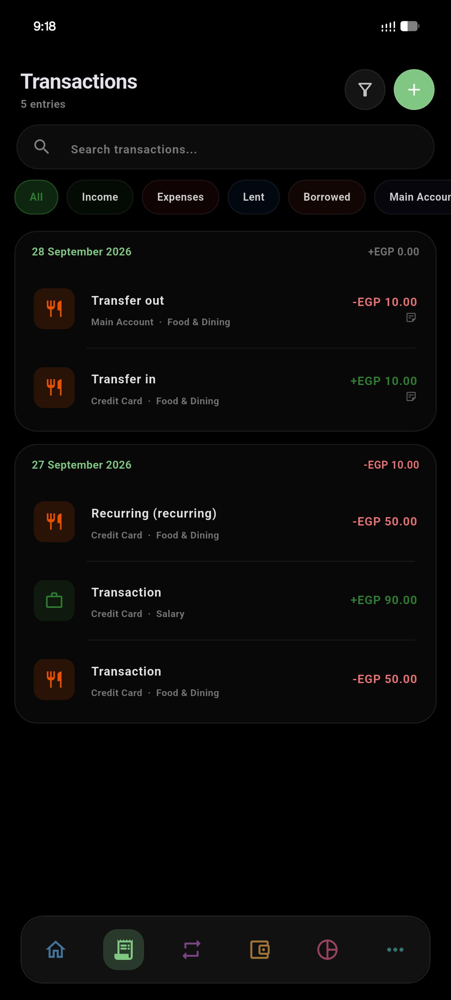
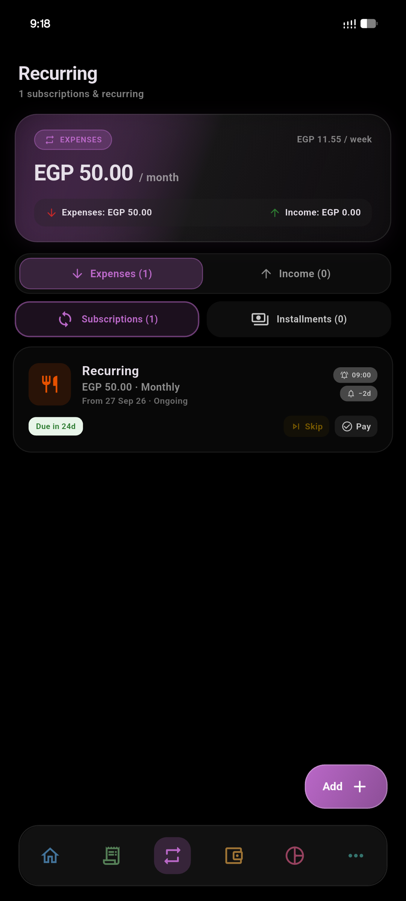
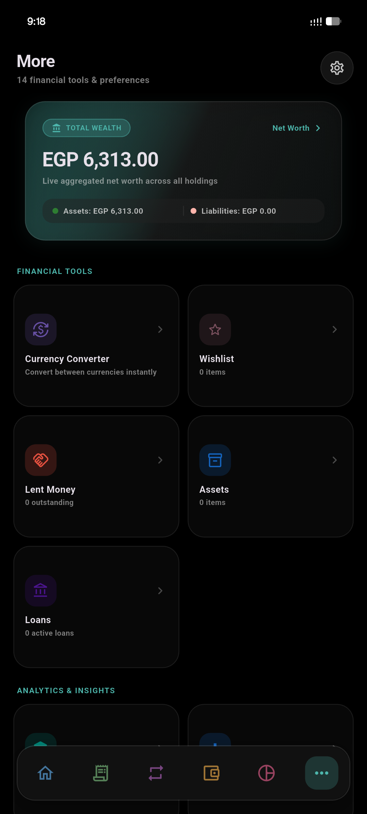

<div align="center">


# Expensy

[](https://developer.android.com) [](https://flutter.dev) [](https://github.com/mina-android/Expensy/releases) [](LICENSE)

<p align="center">
  A local-first personal finance tracker and budget manager for Android that keeps all financial records, accounts, and transaction history strictly on your physical device.
</p>

</div>

---

## Navigation

[Features](#features) &bull; [Screenshots](#screenshots) &bull; [Downloads](#downloads) &bull; [Self Building & Local Setup](#self-building--local-setup) &bull; [Contribution](#contribution) &bull; [About the Developer](#about-the-developer) &bull; [Donate](#donate) &bull; [License](#license)

---

## Features

### Core Capabilities

- **Account & Card Balance Management**: Manage liquid bank accounts, cash wallets, debit cards, credit cards, digital wallets, investments, and physical gold holdings. Debit cards inherit balances directly from linked bank accounts to prevent ledger duplication.
- **Categories & Subcategories**: Organize expenses and income with a clean `Parent › Subcategory` hierarchy, a two-tier progressive category picker, and automatic parent roll-up across budgets and reports.
- **Term Deposits & Certificates of Deposit**: Record fixed-term deposits with customizable yield collection frequencies (daily, monthly, yearly) crediting linked accounts automatically, complete with early redemption calculations.
- **Budgeting with Roll-Over Tracking**: Establish category or subcategory budgets where unused allocations carry forward into subsequent billing cycles, complemented by a Safe-to-Spend daily allowance pacer.
- **Fast Transaction Logging**: Register routine transactions using configurable one-tap presets, split transactions across multiple categories/subcategories, a dedicated `Transfer` category for internal transfers, and an integrated expression-evaluating numeric keypad.
- **Recurring Bills, Installments, Debt & Goals**: Track recurring subscriptions and installments (with background auto-pay and skip/pay progress tracking), incoming/outgoing loans, lent/borrowed contacts, wishlists, and savings goals.
- **Insights, Statistics & Expensy Wrapped**: Explore monthly spending trends, category-matched pie charts with subcategory drill-down, a financial calendar, and a story-style Expensy Wrapped summary.
- **Data Export, Encrypted Backups & Migration**: Export Excel (`.xlsx`) workbooks (with `Category` and `Subcategory` columns) and formatted PDF financial statements, create encrypted (`.enc`) or JSON backups with selective restore and scheduled SAF auto-backup, or migrate directly from **TrackWallet (`.csv`)** and **GreenStash (`.json`)**.
- **Multi-Language & Material You**: Supports Material You dynamic colors, pitch-black AMOLED mode, and 12 languages including English, Arabic, Bangla (`বাংলা`), French, German, Hindi, Spanish, Portuguese, Chinese, Japanese, Russian, and Italian.

### Architecture & Data Handling

- **Local-First Architecture**: All transactional ledgers, accounts, and preferences reside exclusively in an on-device SQLite database. No external account registration or cloud connectivity is required.
- **Zero Outbound Telemetry**: No diagnostic events, behavioral metrics, or personal financial figures are transmitted across the network. Network access is used only to fetch public currency exchange and gold rates.
- **Resource Footprint**: Minimal storage footprint under 30 MB with near-instant startup times and zero persistent background services outside optional local notification triggers.

---

## Screenshots

<table width="100%" border="0" cellspacing="0" cellpadding="4">
  <tr>
    <td width="33.33%" align="center" valign="top">
      
    </td>
    <td width="33.33%" align="center" valign="top">
      
    </td>
    <td width="33.33%" align="center" valign="top">
      
    </td>
  </tr>
  <tr>
    <td width="33.33%" align="center" valign="top">
      
    </td>
    <td width="33.33%" align="center" valign="top">
      
    </td>
    <td width="33.33%" align="center" valign="top">
      
    </td>
  </tr>
  <tr>
    <td width="33.33%" align="center" valign="top">
      
    </td>
    <td width="33.33%" align="center" valign="top">
      
    </td>
    <td width="33.33%" align="center" valign="top">
      
    </td>
  </tr>
</table>

---

## Downloads

Official release packages are published under the [GitHub Releases](https://github.com/mina-android/Expensy/releases) repository page.

| Platform | Architecture | Package Type | Download Link | Notes |
| :--- | :--- | :--- | :--- | :--- |
| **Android** | arm64-v8a | `.apk` | [Download (v1.2.6)](https://github.com/mina-android/Expensy/releases/latest) | Modern 64-bit devices (recommended) |
| **Android** | armeabi-v7a | `.apk` | [Download (v1.2.6)](https://github.com/mina-android/Expensy/releases/latest) | Legacy 32-bit devices |
| **Android** | x86_64 | `.apk` | [Download (v1.2.6)](https://github.com/mina-android/Expensy/releases/latest) | Android emulators and Intel-based tablets |
| **Android** | Universal | `.apk` | [Download (v1.2.6)](https://github.com/mina-android/Expensy/releases/latest) | Combined installer supporting all architectures |

---

## Self Building & Local Setup

### 1. Prerequisites

Ensure your development environment has the following software installed:

- **Flutter SDK**: `3.47.6` or higher (stable channel)
- **Dart SDK**: `3.13.5` or higher
- **Android SDK**: API level `36`
- **Java Development Kit**: JDK `21`
- **Git**: `2.30+`

### 2. Repository Setup

```bash
# Clone the repository
git clone https://github.com/mina-android/Expensy.git

# Navigate into the project root
cd Expensy

# Verify Flutter environment
flutter doctor
```

### 3. Dependency Installation

```bash
# Fetch required Flutter and Dart dependencies
flutter pub get
```

### 4. Build Compilation

```bash
# Compile split per-ABI release APKs
flutter build apk --split-per-abi --release

# Or compile a single universal APK
flutter build apk --release
```

Compiled binaries will be generated inside `build/app/outputs/flutter-apk/`.

### 5. Running the Application Locally

```bash
# Connect a device or launch an emulator, then execute
flutter run --release
```

---

## Contribution

Contributions aimed at bug fixes, translation improvements, and performance optimizations are welcome.

### Contribution Process

1. **Check Issues**: Review existing GitHub Issues to verify whether a problem or enhancement is already documented.
2. **Open a Discussion**: For substantial structural or database schema alterations, open an issue first to discuss the design.
3. **Branching**: Branch off `main` using descriptive branch names (`fix/issue-description` or `feat/feature-name`).
4. **Code Quality**:
   - Ensure code passes static analysis: `flutter analyze`
   - Run unit and widget tests: `flutter test`
5. **Pull Request**: Open a pull request against `main` providing a clear breakdown of changes and relevant issue links.

---

## About the Developer

This project is authored and maintained by **mina-android**, focused on developing transparent, local-first Android utilities and privacy-conscious software.

[](https://portfolio.minaashraf285.workers.dev/) [](https://github.com/mina-android) [](https://github.com/mina-android/Expensy/issues)

---

## Donate

Development and maintenance of this software are independent and self-supported. If this project helps you manage your finances reliably, consider supporting development:

[](https://paypal.me/minaashraf285) [](https://github.com/sponsors/mina-android) [](https://ko-fi.com/minaashraf285)

---

## License

Distributed under the **GNU General Public License v3.0**. See the [`LICENSE`](LICENSE) file in the root directory for the complete legal text.

```text
Copyright (c) 2026 mina-android
Licensed under the GNU General Public License v3.0.
```
