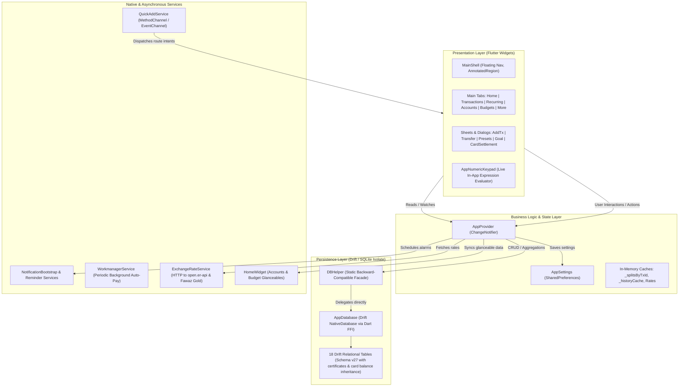
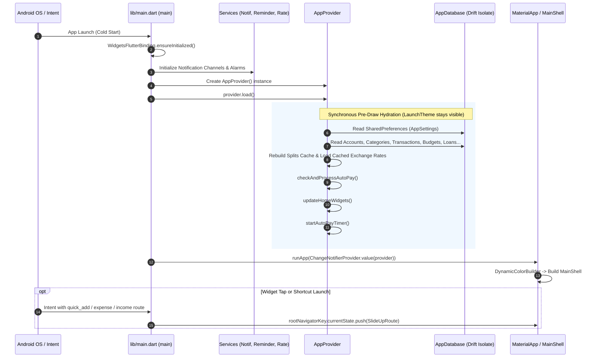
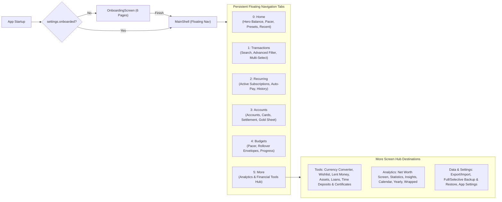
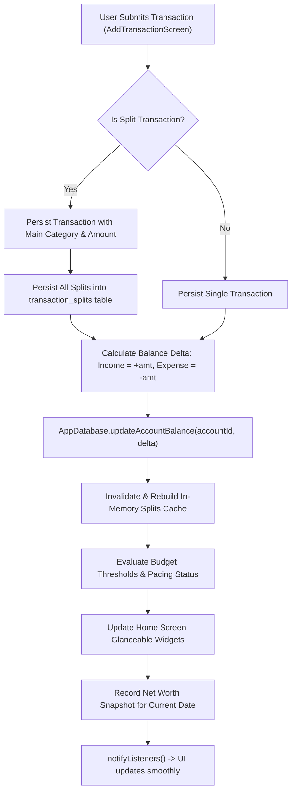
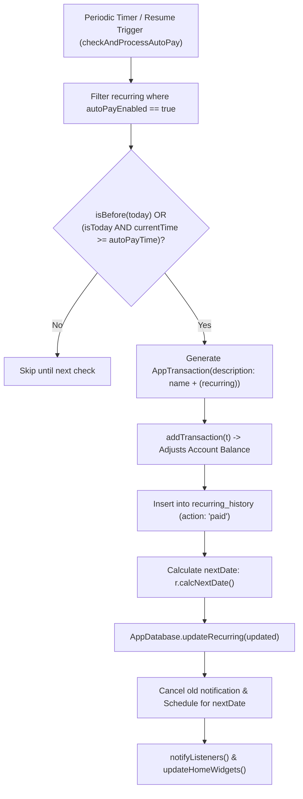
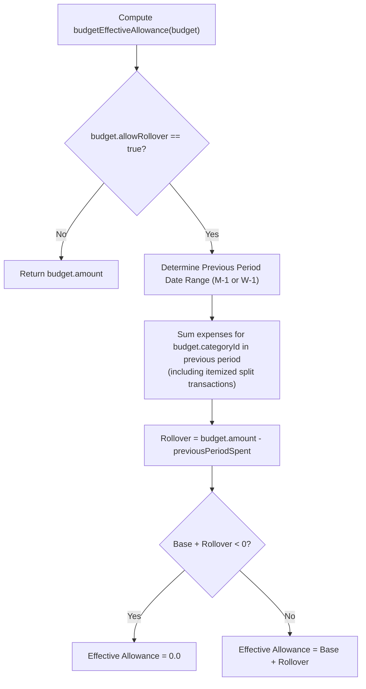
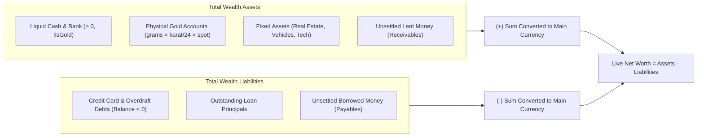
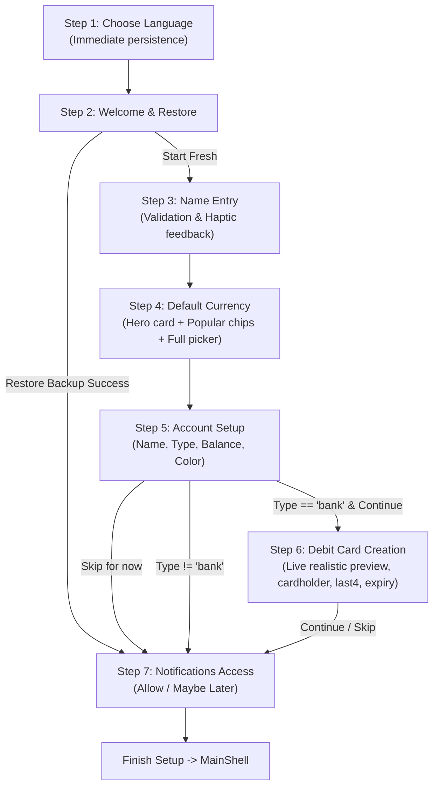

# Expensy System Architecture & Data Flow

This document provides a comprehensive blueprint of the **Expensy** architecture, including entity-relationship database schemas, layer-by-layer software structure, state management pipelines, asynchronous notification systems, and end-to-end user workflows.

---

## 1. High-Level System Architecture

Expensy is built with Flutter and Dart targeting Android. It follows a clean offline-first reactive architecture powered by `Provider` for state management, `Drift` (backed by SQLite via Dart FFI in a background isolate) for relational persistence, and native Android services (AlarmManager, LocalNotifications, HomeWidget, QuickAdd EventChannels).

---

## 2. Database Entity-Relationship Diagram (ERD)

The database runs on SQLite through Drift (`AppDatabase`, Schema Version 27). Operations are executed asynchronously in a background isolate via Dart FFI.

```mermaid
erDiagram
    ACCOUNTS ||--o{ TRANSACTIONS : "holds"
    ACCOUNTS ||--o{ CERTIFICATES : "receives payouts into"
    CATEGORIES ||--o{ TRANSACTIONS : "categorizes"
    TRANSACTIONS ||--o{ TRANSACTION_SPLITS : "split into"
    CATEGORIES ||--o{ TRANSACTION_SPLITS : "assigned to"

    ACCOUNTS ||--o{ RECURRING_PAYMENTS : "debits/credits"
    CATEGORIES ||--o{ RECURRING_PAYMENTS : "categorizes"
    RECURRING_PAYMENTS ||--o{ RECURRING_HISTORY : "tracks"

    CATEGORIES ||--o{ BUDGETS : "limits"

    ACCOUNTS ||--o{ TRANSACTION_PRESETS : "defaults to"
    CATEGORIES ||--o{ TRANSACTION_PRESETS : "defaults to"

    LENDED_PEOPLE ||--o{ LENDED_MONEY : "involves"
    ACCOUNTS ||--o{ LENDED_MONEY : "source account"

    SAVINGS_GOALS ||--o{ SAVINGS_CONTRIBUTIONS : "accumulates"
    ACCOUNTS ||--o{ SAVINGS_CONTRIBUTIONS : "funded by"
    WISHLIST ||--o| SAVINGS_GOALS : "bridges (goal_id / wishlist_item_id)"

    ACCOUNTS ||--o{ LOANS : "disbursement account"
    ACCOUNTS ||--o{ LOANS : "repayment account"
    LOANS ||--o{ LOAN_PAYMENTS : "repaid by"
    ACCOUNTS ||--o{ LOAN_PAYMENTS : "paid from"

    ACCOUNTS {
        TEXT id PK
        TEXT name
        TEXT type "cash | bank | credit | savings | investment | wallet"
        REAL balance
        TEXT currency
        INTEGER color_value
        INTEGER exclude_from_total
        INTEGER exclude_from_bank_total
        INTEGER dont_link_to_card
        INTEGER gold_karat "Nullable: 18, 21, 22, 24"
        REAL gold_grams "Nullable: physical weight"
        TEXT card_holder_name "Nullable: Credit card"
        TEXT card_number_last4 "Nullable: Credit card"
        TEXT card_expiry "Nullable: MM/YY"
        INTEGER statement_day "Nullable: 1-31"
        INTEGER due_day "Nullable: 1-31"
        REAL credit_limit "Nullable"
        REAL min_payment_amount "Nullable"
        REAL min_payment_percent "Nullable"
        INTEGER credit_reminder_enabled
        TEXT credit_reminder_time
        INTEGER credit_early_reminder_enabled
        TEXT linked_account_id "FK -> accounts.id (Parent Bank)"
        INTEGER order_index
        TEXT created_at
    }

    CATEGORIES {
        TEXT id PK
        TEXT name
        TEXT type "expense | income"
        INTEGER color_value
        INTEGER icon_code_point
        INTEGER order_index
    }

    TRANSACTIONS {
        TEXT id PK
        TEXT type "expense | income"
        REAL amount
        TEXT description
        TEXT account_id FK
        TEXT category_id FK
        TEXT date "ISO8601"
        TEXT note
        TEXT currency "Empty string = match account"
        TEXT transfer_group_id "Nullable: links paired transfer legs"
    }

    TRANSACTION_SPLITS {
        TEXT id PK
        TEXT transaction_id FK
        TEXT category_id FK
        REAL amount
        TEXT note
    }

    RECURRING_PAYMENTS {
        TEXT id PK
        TEXT name
        TEXT account_id FK
        TEXT category_id FK
        REAL amount
        TEXT payment_type "expense | income"
        INTEGER freq_val
        TEXT freq_unit "days | weeks | months | years"
        TEXT start_date "ISO8601"
        TEXT next_date "ISO8601"
        TEXT end_date "Nullable ISO8601"
        INTEGER paid_payments
        INTEGER reminder_enabled
        TEXT reminder_time "HH:mm"
        INTEGER early_reminder_enabled
        TEXT notes
        TEXT recurring_type "subscription | utility | salary | etc"
        INTEGER auto_pay_enabled
        TEXT auto_pay_time "HH:mm"
    }

    RECURRING_HISTORY {
        TEXT id PK
        TEXT recurring_id FK
        TEXT action "paid | skipped"
        TEXT date "ISO8601"
        REAL amount
        TEXT currency
    }

    BUDGETS {
        TEXT id PK
        TEXT category_id FK
        REAL amount
        TEXT period "monthly | weekly"
        INTEGER allow_rollover "Envelope roll-over toggle"
        TEXT created_at "ISO8601"
    }

    TRANSACTION_PRESETS {
        TEXT id PK
        TEXT title
        TEXT type "expense | income"
        REAL amount
        TEXT account_id FK
        TEXT category_id FK
        TEXT currency
        TEXT note
        INTEGER color_value
        INTEGER icon_code_point
        INTEGER order_index
        TEXT created_at "ISO8601"
    }

    LENDED_PEOPLE {
        TEXT id PK
        TEXT name
        INTEGER color_value
        TEXT notes
        TEXT created_at "ISO8601"
    }

    LENDED_MONEY {
        TEXT id PK
        TEXT person_id FK
        REAL amount
        TEXT type "lent | borrowed"
        TEXT account_id FK
        INTEGER is_settled
        TEXT date "ISO8601"
        TEXT due_date "Nullable ISO8601"
        TEXT notes
        INTEGER reminder_enabled
        TEXT reminder_time "HH:mm"
    }

    WISHLIST {
        TEXT id PK
        TEXT name
        REAL target_price
        TEXT priority "low | medium | high"
        INTEGER is_purchased
        TEXT notes
        TEXT goal_id FK "Nullable -> savings_goals.id"
        TEXT created_at "ISO8601"
    }

    SAVINGS_GOALS {
        TEXT id PK
        TEXT name
        REAL target_amount
        REAL current_amount
        TEXT currency
        TEXT target_date "Nullable ISO8601"
        INTEGER color_value
        INTEGER is_completed
        TEXT wishlist_item_id FK "Nullable -> wishlist.id"
        TEXT created_at "ISO8601"
        TEXT completed_at "Nullable ISO8601"
    }

    SAVINGS_CONTRIBUTIONS {
        TEXT id PK
        TEXT goal_id FK
        REAL amount
        TEXT account_id FK
        TEXT type "contribution | withdrawal"
        TEXT date "ISO8601"
        TEXT note
    }

    LOANS {
        TEXT id PK
        TEXT name
        REAL principal
        TEXT currency
        TEXT start_date "ISO8601"
        TEXT end_date "ISO8601"
        REAL interest_rate "Nullable"
        TEXT account_id FK "Nullable: liability tracking"
        TEXT transfer_account_id FK "Nullable: funding source"
        INTEGER reminder_enabled
        INTEGER reminder_day
        TEXT reminder_time "HH:mm"
        INTEGER is_settled
        TEXT notes
        TEXT created_at "ISO8601"
    }

    LOAN_PAYMENTS {
        TEXT id PK
        TEXT loan_id FK
        TEXT date "ISO8601"
        REAL amount
        TEXT currency
        TEXT account_id FK "Nullable"
        TEXT notes
    }

    ASSETS {
        TEXT id PK
        TEXT name
        REAL value
        TEXT currency
        TEXT notes
        TEXT created_at "ISO8601"
    }

    CERTIFICATES {
        TEXT id PK
        TEXT name
        REAL amount
        TEXT currency
        TEXT start_date "ISO8601"
        TEXT end_date "ISO8601"
        REAL interest_rate
        TEXT collection_type "daily | monthly | yearly"
        INTEGER collection_day "1-31"
        REAL custom_payout_amount "Nullable"
        TEXT account_id FK "-> accounts.id (Linked Bank Account)"
        INTEGER reminder_enabled
        TEXT reminder_time "HH:mm"
        INTEGER reminder_early_enabled "0 or 1"
        TEXT notes
        INTEGER is_settled
        TEXT created_at "ISO8601"
        TEXT last_collected_date "Nullable ISO8601"
        REAL total_collected_amount
    }

    NET_WORTH_SNAPSHOTS {
        TEXT id PK
        TEXT date "yyyy-MM-dd UNIQUE"
        REAL total_accounts
        REAL total_assets
        REAL net_worth
        TEXT currency
    }
```

---

## 3. Application Lifecycle & Startup Sequence

When the app launches from cold start or receives an intent from a homescreen widget or app shortcut, initialization runs through strict synchronization:

---

## 4. Complete Application Flow & Navigation Architecture

The app uses a 6-tab persistent bottom navigation bar inside `MainShell` wrapped in an edge-to-edge transparent system overlay:

---

## 5. Core Business Logic & Data Mutation Pipelines

### 5.1 Transaction Creation & Balance Synchronization
When a transaction is created, updated, or deleted, balance deltas are updated across linked accounts and net worth snapshots:

### 5.2 Auto-Pay on Due Date for Recurring Payments
Recurring items can automatically generate expense transactions on their scheduled due date and time:

### 5.3 Rollover (Envelope) Budgeting Engine
Budgets can preserve surpluses or penalize overspending into the subsequent period:

### 5.4 Net Worth Computation
Net Worth is calculated live across liquid cash, foreign exchange rates, spot gold prices, fixed assets, and liabilities:

### 5.4 Time Deposits Lifecycle & Balance Recovery Cascade
When a certificate / time deposit is created, principal deduction transactions are tagged with `[cert:<id>]`. Yield payouts collected over time are similarly tracked. Upon deletion of a certificate:
1. All linked transactions (both initial principal deduction and collected interest payments) are identified in `AppDatabase.transactions`.
2. Each transaction is deleted using `DBHelper.applyDeleteTransactionWithBalance`, reversing the balance delta on the linked bank account.
3. In-memory accounts are updated via `_patchAccountBalance`, restoring the account balance exactly to its pre-deposit state without leaving orphan transaction logs.
4. Payout reminders are scheduled through `CertificateReminderService` on the collection due date and optionally 2 days early at the designated `reminder_time`.

### 5.5 Account & Card View Partitioning
Accounts and cards are presented cleanly across dedicated views:
- **Home Screen Carousels:** The Home screen features two dedicated horizontal carousels:
  1. **Accounts Carousel:** Displays non-card liquid accounts (`app.accounts.where((a) => !a.isCard)`: Bank, Cash, Savings, Digital Wallet, Gold) with a dedicated "+ Add Account" action tile.
  2. **Cards Carousel:** Displays registered cards (`app.accounts.where((a) => a.isCard)`: Debit, Credit, Prepaid) with card numbers, contactless indicators, effective balances, and a dedicated "+ Add Card" action tile.
  Both carousels link their "Manage →" actions via `AppProvider.accountsTabNotifier` (`0` for Accounts, `1` for Cards) directly into the `AccountsScreen`.
- **Accounts Tab - Accounts & Cards Views:** `AccountsScreen` hosts two synchronized sub-tabs:
  1. **Accounts Tab (`_tabIndex = 0`):** Full dashboard of all asset-holding liquid accounts.
  2. **Cards Tab (`_tabIndex = 1`):** Complete management of Debit, Credit, and Prepaid cards with inline type badges placed beside card names.

---

## 6. Battery, Background & Resource Management

1. **Lifecycle-Aware Timer Pausing:**
   - `_MainShellState` implements `WidgetsBindingObserver`.
   - On `AppLifecycleState.paused` or `AppLifecycleState.detached`, `AppProvider.pauseAutoPayTimer()` terminates Dart VM timer wakeups.
   - On `AppLifecycleState.resumed`, `AppProvider.startAutoPayTimer()` immediately checks auto-pay and restarts the 1-minute loop.

2. **Network Request Throttling:**
   - `ExchangeRateService.shouldAttemptFetch()` prevents repeated HTTP calls to `open.er-api.com` and metals APIs. If a fetch fails (e.g. offline, timeout), a 15-minute cooldown is enforced before another background attempt is permitted.

3. **In-Isolate Database Execution:**
   - All SQLite queries and schema migrations run through `NativeDatabase.createInBackground(file)` in Drift, ensuring heavy table scans, full text searches, and aggregations never drop UI frames on the main Flutter thread.

4. **Memoized Filter Caching:**
   - `TransactionsScreen` memoizes the unified search and sort pass across transactions, lended items, savings contributions, and loans via `_lastFilterSignature`, eliminating redundant loop evaluations on every widget rebuild or cursor animation.

---

## 7. Onboarding & Navigation Layout Metrics

### 7.1 Modern Fintech Onboarding Architecture
The initial onboarding experience runs as an indexed stack of seven fintech steps with reactive conditional branches:

### 7.2 Navigation Metrics & Dynamic Clearance
`NavMetrics` (`lib/utils/nav_metrics.dart`) decouples bottom navigation height and system window insets from individual screens:
- **`NavBarFrame`:** Anchors the floating navigation bar with responsive bottom margins and device window insets.
- **`NavAwareFabLocation`:** Position floating action buttons dynamically above the floating navbar factoring text direction (`LTR`/`RTL`) and `NavMetrics.fabBottomOffset(context)`.
- **`NavMetrics.scrollBottomPadding(context)`:** Injects dynamic bottom scroll padding across all list views to prevent content occlusion.
